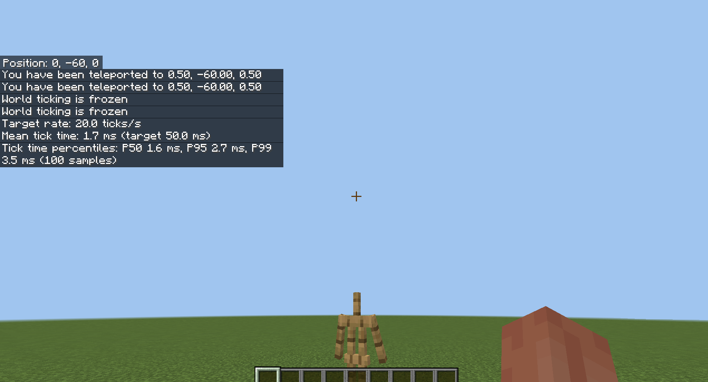

# TickCommand for Bedrock

[English](README.md) | [简体中文](README.zh-CN.md) | [繁體中文](README.zh-TW.md)



Java 版の `/tick` コマンドを、同じ構文で Minecraft 統合版に追加します。[LeviLamina](https://github.com/LiteLDev/LeviLamina) 用のネイティブ Mod です。クライアントに入れるとそのクライアントで開いたワールドで、専用サーバーに入れるとそのサーバーで使えます。

> 非公式の Mod です。Minecraft の公式製品ではなく、Mojang および Microsoft による承認や関係はありません。

## 動作環境

|  | バージョン |
|---|---|
| Minecraft 統合版 | 1.26.60 (Windows client / server) |
| LeviLamina | 26.60.x |

## 導入

```
lip install github.com/ch1-k-mc/TickCommand-Bedrock
```

ゲームまたはサーバーのフォルダで実行します。同じパッケージで、それぞれに合ったビルドが入ります。

**手動**: [Releases](../../releases) から `TickCommand-client-windows-x64.zip`（クライアント）または `TickCommand-server-windows-x64.zip`（サーバー）を取得し、`TickCommand` フォルダを `mods/` に展開します。

## コマンド

| コマンド | 内容 |
|---|---|
| `/tick query` | 状態・目標レート・tick 時間を表示 |
| `/tick rate <rate>` | 目標レートを設定（1.0〜10000.0、既定 20） |
| `/tick freeze` | ワールドを凍結。プレイヤーと乗っているものは動ける |
| `/tick unfreeze` | ワールドを再開 |
| `/tick step [<time>]` | 凍結中に `time` だけ進める（既定 1 tick） |
| `/tick step stop` | 進行中のステップを止める |
| `/tick sprint [<time>]` | `time` + 1 tick を最高速で進め、元の状態に戻して速度を報告 |
| `/tick sprint stop` | 進行中のスプリントを止める |

## 時間の書き方

`20` または `20t` = tick、`1.5s` = 秒（20 tick）、`.5d` = ゲーム内の日（24000 tick）。1 tick 以上になる値を指定します。

## 動作

- オペレーター権限が必要です。コマンドブロックからは実行できません。
- メッセージは各プレイヤーのゲーム言語（英語・日本語・簡体字・繁体字）で表示します。サーバーのコンソールは英語です。
- 状態はワールドやサーバーの再起動で元に戻ります。
- 凍結中はモブ、ブロックの tick、ブロックエンティティ、レッドストーン、時刻が止まります。プレイヤーの周りのチャンクは読み込まれます。

## 制限

- メッセージは独自の文言で、Java 版とは異なります。
- クライアント側のアニメーションはサーバーの tick レートに追従しません。
- 実際に出せる最高レートは CPU とワールドの重さで決まります。追いつけない分の tick は切り捨てます。

## ビルド

[xmake](https://xmake.io)、Visual Studio 2022 以降、clang-cl が必要です。

```
xmake f -m release -y
xmake
```

`bin/TickCommand/` に出力されます。サーバー版は `--target_type=server` を付けます。

## ライセンス

[MIT](LICENSE)。[NOTICE](NOTICE.md) も参照してください。
