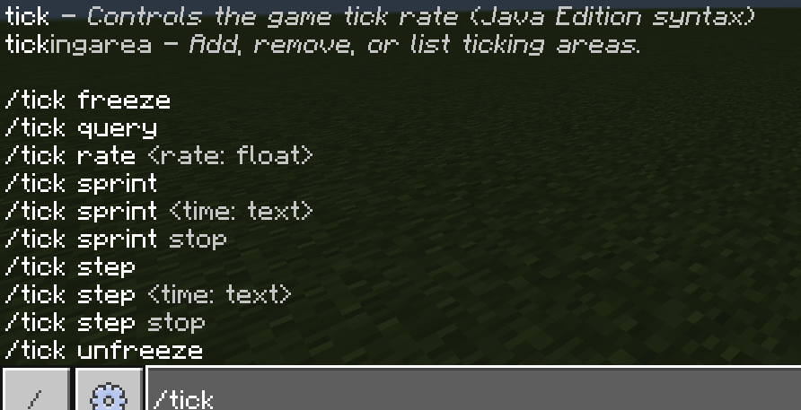

# TickCommand for Bedrock

[日本語](README.ja.md) | [简体中文](README.zh-CN.md) | [繁體中文](README.zh-TW.md)



Adds the Java Edition `/tick` command, with the same syntax, to Minecraft: Bedrock Edition. A native mod for [LeviLamina](https://github.com/LiteLDev/LeviLamina). Install it on a client to use it in worlds opened by that client, or on a dedicated server to use it there.

> Unofficial. Not an official Minecraft product and not approved by or associated with Mojang or Microsoft.

## Requirements

|  | Version |
|---|---|
| Minecraft: Bedrock Edition | 1.26.60 (Windows client / server) |
| LeviLamina | 26.60.x |

## Installation

```
lip install github.com/ch1-k-mc/TickCommand-Bedrock
```

Run it in the game or server directory. The same package installs the right build on each side.

**Manual**: download `TickCommand-client-windows-x64.zip` (client) or `TickCommand-server-windows-x64.zip` (server) from [Releases](../../releases) and extract the `TickCommand` folder into `mods/`.

## Commands

| Command | Effect |
|---|---|
| `/tick query` | Shows the status, target rate and tick times |
| `/tick rate <rate>` | Sets the target rate (1.0 to 10000.0, default 20) |
| `/tick freeze` | Freezes the world. Players and what they ride keep moving |
| `/tick unfreeze` | Resumes the world |
| `/tick step [<time>]` | While frozen, advances by `time` (default 1 tick) |
| `/tick step stop` | Stops the current step |
| `/tick sprint [<time>]` | Runs `time` + 1 ticks as fast as possible, then restores the previous state and reports the speed |
| `/tick sprint stop` | Stops the current sprint |

## Time values

`20` or `20t` = ticks, `1.5s` = seconds (20 ticks), `.5d` = in-game days (24000 ticks). The result must be at least 1 tick.

## Behavior

- Requires operator permission. Cannot be run from command blocks.
- Messages follow each player's game language: English, Japanese, Simplified Chinese or Traditional Chinese. The server console uses English.
- The state is reset when the world or server restarts.
- While frozen, mobs, block ticks, block entities, redstone and the time of day stop. Chunks keep loading around players.

## Limitations

- Message wording is original and differs from Java Edition.
- Client-side animations do not follow the server tick rate.
- The highest reachable rate depends on the CPU and world. Ticks that cannot keep up are dropped.

## Building

Requires [xmake](https://xmake.io), Visual Studio 2022 or later, and clang-cl.

```
xmake f -m release -y
xmake
```

The mod is output to `bin/TickCommand/`. Use `--target_type=server` for the server build.

## License

[MIT](LICENSE). See [NOTICE](NOTICE.md).
