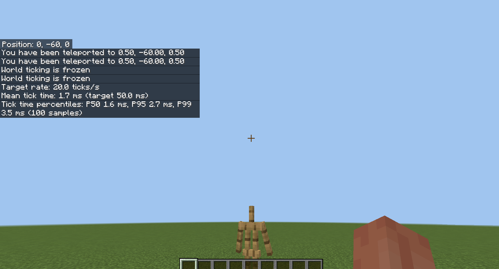

# TickCommand for Bedrock

[English](README.md) | [日本語](README.ja.md) | [繁體中文](README.zh-TW.md)



以相同语法为 Minecraft 基岩版添加 Java 版的 `/tick` 命令。这是 [LeviLamina](https://github.com/LiteLDev/LeviLamina) 原生模组。安装到客户端后可在该客户端打开的世界中使用，安装到专用服务器后可在该服务器上使用。

> 非官方模组。不是 Minecraft 官方产品，未获得 Mojang 或 Microsoft 的认可，也与其无关。

## 运行环境

|  | 版本 |
|---|---|
| Minecraft 基岩版 | 1.26.60 (Windows client / server) |
| LeviLamina | 26.60.x |

## 安装

```
lip install github.com/ch1-k-mc/TickCommand-Bedrock
```

在游戏或服务器目录中运行。同一个包会为两端安装对应的构建。

**手动**：从 [Releases](../../releases) 下载 `TickCommand-client-windows-x64.zip`（客户端）或 `TickCommand-server-windows-x64.zip`（服务器），将 `TickCommand` 文件夹解压到 `mods/`。

## 命令

| 命令 | 作用 |
|---|---|
| `/tick query` | 显示状态、目标速率和 tick 耗时 |
| `/tick rate <rate>` | 设置目标速率（1.0 到 10000.0，默认 20） |
| `/tick freeze` | 冻结世界。玩家及其骑乘物仍可移动 |
| `/tick unfreeze` | 恢复世界 |
| `/tick step [<time>]` | 冻结时前进 `time`（默认 1 tick） |
| `/tick step stop` | 停止当前步进 |
| `/tick sprint [<time>]` | 以最快速度运行 `time` + 1 tick，然后恢复之前的状态并报告速度 |
| `/tick sprint stop` | 停止当前冲刺 |

## 时间格式

`20` 或 `20t` = tick，`1.5s` = 秒（20 tick），`.5d` = 游戏日（24000 tick）。结果至少为 1 tick。

## 行为

- 需要管理员权限。不能从命令方块执行。
- 消息使用每位玩家的游戏语言（英语、日语、简体中文、繁体中文）。服务器控制台使用英语。
- 世界或服务器重启后状态会重置。
- 冻结时生物、方块 tick、方块实体、红石和昼夜时间都会停止。玩家周围的区块仍会加载。

## 限制

- 消息为原创文字，与 Java 版不同。
- 客户端动画不跟随服务器 tick 速率。
- 实际可达到的最高速率取决于 CPU 和世界负载。跟不上的 tick 会被丢弃。

## 构建

需要 [xmake](https://xmake.io)、Visual Studio 2022 或更高版本以及 clang-cl。

```
xmake f -m release -y
xmake
```

输出到 `bin/TickCommand/`。服务器版请加 `--target_type=server`。

## 许可证

[MIT](LICENSE)。另见 [NOTICE](NOTICE.md)。
