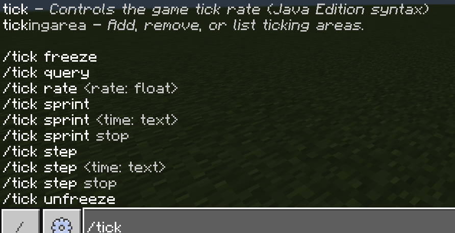

# TickCommand for Bedrock

[English](README.md) | [日本語](README.ja.md) | [简体中文](README.zh-CN.md)



以相同語法為 Minecraft 基岩版加入 Java 版的 `/tick` 指令。這是 [LeviLamina](https://github.com/LiteLDev/LeviLamina) 原生模組。安裝到用戶端後可在該用戶端開啟的世界中使用，安裝到專用伺服器後可在該伺服器上使用。

> 非官方模組。不是 Minecraft 官方產品，未獲得 Mojang 或 Microsoft 的認可，也與其無關。

## 執行環境

|  | 版本 |
|---|---|
| Minecraft 基岩版 | 1.26.60 (Windows client / server) |
| LeviLamina | 26.60.x |

## 安裝

```
lip install github.com/ch1-k-mc/TickCommand-Bedrock
```

在遊戲或伺服器資料夾中執行。同一個套件會為兩端安裝對應的建置。

**手動**：從 [Releases](../../releases) 下載 `TickCommand-client-windows-x64.zip`（用戶端）或 `TickCommand-server-windows-x64.zip`（伺服器），將 `TickCommand` 資料夾解壓縮到 `mods/`。

## 指令

| 指令 | 作用 |
|---|---|
| `/tick query` | 顯示狀態、目標速率和 tick 耗時 |
| `/tick rate <rate>` | 設定目標速率（1.0 到 10000.0，預設 20） |
| `/tick freeze` | 凍結世界。玩家及其騎乘物仍可移動 |
| `/tick unfreeze` | 恢復世界 |
| `/tick step [<time>]` | 凍結時前進 `time`（預設 1 tick） |
| `/tick step stop` | 停止目前的步進 |
| `/tick sprint [<time>]` | 以最快速度執行 `time` + 1 tick，然後恢復先前的狀態並回報速度 |
| `/tick sprint stop` | 停止目前的衝刺 |

## 時間格式

`20` 或 `20t` = tick，`1.5s` = 秒（20 tick），`.5d` = 遊戲日（24000 tick）。結果至少為 1 tick。

## 行為

- 需要管理員權限。不能從指令方塊執行。
- 訊息使用每位玩家的遊戲語言（英文、日文、簡體中文、繁體中文）。伺服器主控台使用英文。
- 世界或伺服器重新啟動後狀態會重設。
- 凍結時生物、方塊 tick、方塊實體、紅石和晝夜時間都會停止。玩家周圍的區塊仍會載入。

## 限制

- 訊息為原創文字，與 Java 版不同。
- 用戶端動畫不跟隨伺服器 tick 速率。
- 實際可達到的最高速率取決於 CPU 和世界負載。跟不上的 tick 會被捨棄。

## 建置

需要 [xmake](https://xmake.io)、Visual Studio 2022 或更新版本以及 clang-cl。

```
xmake f -m release -y
xmake
```

輸出到 `bin/TickCommand/`。伺服器版請加上 `--target_type=server`。

## 授權

[MIT](LICENSE)。另見 [NOTICE](NOTICE.md)。
